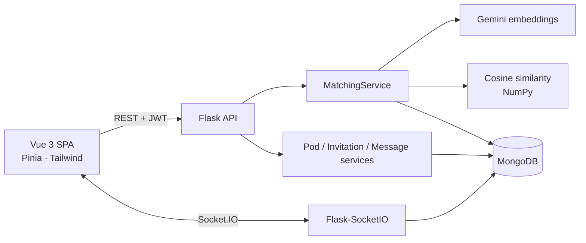

# CliqueAI — semantic matching into small, time-limited "pods"

**Built over a hackathon weekend (Feb 2026)** · Sole developer · **Stack:** Python · Flask · Flask-SocketIO · MongoDB · Google Gemini embeddings · NumPy · Vue 3 · Pinia · Vite · Tailwind · pytest

CliqueAI puts people into small groups ("pods") with others who want to work on, talk about or get support for the same thing. Instead of keyword tags, it compares the **meaning** of what users write, using Gemini embeddings and cosine similarity, then lets matched users form a pod and chat in real time while it is active.

## Highlights

- **Semantic matching:** a user's free-text focus is embedded with Gemini; candidates with the same goal type (`evolve`, `enjoy`, `support`) who are not already in a pod are ranked by cosine similarity, and the top 4 are returned.
- **Real-time pod chat** over WebSockets (Flask-SocketIO); messages are stored in MongoDB with read receipts.
- **Pods with a lifetime:** a member cap, an expiry time and an optional Gemini-generated icebreaker.
- **Secure API:** JWT auth, rate limiting (Flask-Limiter), CORS and Pydantic-validated models.
- **74 pytest tests** covering auth, database, embeddings, matching, messages, pods and an integration flow, with Gemini mocked so tests run offline.

## Architecture



## How it works

1. A user registers and completes onboarding, choosing a match type (`evolve`, `enjoy`, or `support`) and text that describes their current focus.
2. The backend calls Gemini to embed that focus text and stores the vector on the user for matching.
3. `MatchingService` loads other users with the same match type who are available, computes cosine similarity between embeddings, and returns the top matches.
4. Users send invitations or accept flows as implemented in the invitation and application routes; pods are created with metadata and expiry.
5. Messages are stored in MongoDB and pushed to clients over Socket.IO so everyone in a pod sees new messages without full page reloads.

Configuration is driven by environment variables (see `.env.example`): MongoDB URI, JWT secret, Gemini API key, and CORS origins for the Vue dev server.

## Project structure

```
backend/
├── config/           # MongoDB connection
├── models/           # User, pod, message, invitation, application, etc.
├── routes/           # Flask blueprints (auth, matching, pods, messages, ...)
├── services/         # Gemini, matching, pods, invitations, auth, ...
├── tasks/            # Matching-related jobs
└── utils/            # Embeddings helpers
frontend/
├── src/
│   ├── components/   # Onboarding, matching, messaging, common UI
│   ├── views/        # Pages (login, dashboard, pod chat, ...)
│   ├── stores/       # Pinia stores
│   ├── services/     # API client
│   └── router/
├── vite.config.js    # Dev server proxies /api to Flask
└── package.json
tests/                # pytest suite (mocked external APIs where appropriate)
scripts/              # DB checks, seed data, maintenance scripts
```

## Setup

### Backend

1. **Install dependencies:**
   ```bash
   pip install -r requirements.txt
   ```

2. **Set up MongoDB:**
   - Install [MongoDB Community](https://www.mongodb.com/try/download/community)
   - Start MongoDB: `mongod` (on Windows: `net start MongoDB` if installed as a service)
   - Verify: `python scripts/check_db.py`

3. **Configure environment variables:**  
   Copy `.env.example` to `.env` and set:
   ```
   MONGODB_URI=mongodb://localhost:27017/hacketon
   JWT_SECRET_KEY=your-secret-key-change-in-production
   GEMINI_API_KEY=your_gemini_api_key_here
   CORS_ORIGINS=http://localhost:5173,http://localhost:3000
   ```

4. **Run the API** (from the project root):
   ```bash
   python -m backend.app
   ```
   Defaults to port `5000` unless `PORT` is set. Health check: `GET /health`.

### Frontend

1. **Install dependencies:**
   ```bash
   cd frontend
   npm install
   ```

2. **Run the dev server** (with the backend running):
   ```bash
   npm run dev
   ```
   Vite is configured to proxy `/api` to `http://localhost:5000`. Adjust `frontend/vite.config.js` if your API port differs.

3. **Production build:**
   ```bash
   npm run build
   ```
   Output goes to `frontend/dist/` (ignored by git).

### Tests

```bash
pytest tests/ -v
```

Tests mock external APIs where needed so CI and local runs do not require live Gemini calls.

## Database schema (overview)

### Users

- Identifiers, credentials, profile fields (interests, work area, goals, struggles).
- `matching_preferences`: `match_type` (`evolve` | `enjoy` | `support`), focus text, `focus_embedding` (Gemini vector), timestamps.
- `active_pod_id` when the user is in an active pod.

### Pods

- `pod_type` aligned with match type, member list, creation and expiry times, activity flags, optional Gemini-generated icebreaker and focus context.

### Messages

- Linked to `pod_id` and `sender_id`, content, timestamp, read receipts.

(Exact fields are defined in the Pydantic/Mongo models under `backend/models/`.)

## Matching algorithm

The `find_matches()` flow in `MatchingService`:

1. Takes `user_id`, `match_type`, and `focus_text`.
2. Generates a Gemini embedding for `focus_text` and persists it on the user.
3. Queries candidates with the same `match_type`, valid embeddings, not in an active pod, excluding self.
4. Ranks by cosine similarity and returns the top matches (up to four).

## Gemini usage

`GeminiService` provides embedding generation for matching and can generate icebreaker copy for pods using the configured Gemini models (see `backend/services/gemini_service.py`).
